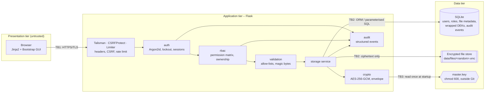

# SecureVault – Architecture

## 1. Three-tier architecture

| Tier | Components |
|---|---|
| Presentation | Browser GUI: login, change password, *My documents* (Staff), *User management* (Admin), *Audit log* (Auditor). No inline JS/CSS so the CSP can forbid them. |
| Application | Flask app split into modules: `security/passwords.py`, `security/rbac.py`, `security/validation.py`, `security/crypto.py`, `security/audit.py`, `services/storage.py`, and route blueprints. |
| Data | SQLite database (metadata, wrapped keys, audit events), encrypted file store on disk, and the master key in a separate permission-restricted file. |

## 2. Trust boundaries

| ID | Boundary | Controls |
|---|---|---|
| **TB1** | Browser → server | TLS (local cert) + HSTS; all input treated as untrusted and validated server-side; CSRF token on every POST; strict SameSite/HttpOnly/Secure cookies; CSP; login rate limit; generic error pages (no stack traces). |
| **TB2** | Application → storage | Files written only as ciphertext under random 64-hex names created with `O_EXCL`; resolved paths must stay inside the store; database accessed only through the SQLAlchemy ORM (parameterised queries). |
| **TB3** | Application → key material | Master key in its own file, separate from DB and file store, mode 600 enforced at startup; never logged, never in `repr()`, never committed (`secrets/`, `*.key` git-ignored). |

## 3. Data flows

### Upload
1. Staff submits the multipart form (CSRF token checked; `MAX_CONTENT_LENGTH` caps the body).
2. `permission_required(MANAGE_OWN_FILES)` checks role.
3. `validate_upload`: sanitise display name → extension allow-list → non-empty → ≤ 10 MB → magic bytes match extension (DOCX: zip structure, no macros, zip-bomb guard; TXT: valid UTF-8, no NUL/control chars, no binary signature).
4. `storage.save_encrypted`: random `storage_name`; new 256-bit DEK and 96-bit nonce; `AES-GCM(DEK).encrypt(plaintext, AAD=storage_name‖owner_id)`; DEK wrapped with master key (fresh nonce, AAD includes key version); SHA-256 of plaintext computed.
5. Ciphertext written to `data/files/<storage_name>.enc`; metadata, nonces, wrapped DEK and digest stored in the DB.
6. `file_upload` audit event.

### Download
1. Route only accepts an integer id (`/files/<int:id>/download`), so traversal strings never match.
2. Ownership check: record must exist **and** `owner_id == current_user.id`; otherwise 404 (+ `access_denied` event if it belonged to someone else).
3. Unwrap DEK (GCM tag on the wrapped key) → decrypt file (GCM tag on ciphertext) → recompute SHA-256 and compare in constant time.
4. Any failure → download blocked, file marked *Failed*, `integrity_failure` event. Success → sent as an attachment with `Cache-Control: no-store` and `nosniff`.

### Delete
CSRF-protected POST → ownership check → DB row (including the wrapped DEK) deleted → ciphertext unlinked. Removing the wrapped DEK is crypto-shredding: any surviving copy of the ciphertext becomes undecryptable.

## 4. Role / permission matrix

| Capability | Admin | Staff | Auditor |
|---|:-:|:-:|:-:|
| Sign in, change own password | ✔ | ✔ | ✔ |
| Create users, assign roles, lock/unlock, reset passwords | ✔ | ✘ | ✘ |
| Upload / list / download / verify / delete **own** files | ✘ | ✔ | ✘ |
| Access another user's files | ✘ | ✘ | ✘ |
| View & filter audit log (read-only) | ✘ | ✘ | ✔ |
| See document contents or names in audit view | ✘ | – | ✘ |

Enforcement points:
* `security/rbac.py` – `ROLE_PERMISSIONS` (deny by default) and `permission_required` decorator on every protected route; denials are audited.
* `routes/files.py` – every file query scoped by owner (complete mediation, prevents IDOR).
* `app/__init__.py` – `user_loader` rejects locked users and sessions whose `session_nonce` was rotated (password change, role change, lock).
* Admins cannot change their own role or lock themselves out.

## 5. Cryptographic design

| Item | Choice |
|---|---|
| File cipher | AES-256-GCM, unique random 256-bit DEK per file, unique 96-bit random nonce |
| Key wrapping | AES-256-GCM with the master key (KEK); random nonce; AAD = `storage_name`, `owner_id`, `key_version` |
| File AAD | `securevault:v1:file:<storage_name>:<owner_id>` – prevents swapping ciphertext between records or owners |
| Integrity | GCM authentication tag + SHA-256 of plaintext compared with `hmac.compare_digest` |
| Master key | 256-bit random, base64 in `v<version>:<key>` format, mode 600, loaded once at startup |
| Rotation | `flask rotate-master-key` re-wraps only DEKs (ciphertext untouched), increments key version |
| Passwords | Argon2id (argon2-cffi defaults, RFC 9106 low-memory profile), automatic rehash on login if parameters change |

## 6. Session management

* Server-signed cookie session; `session.clear()` on login (fixation defence) and logout.
* Flask-Login id = `<user_id>:<session_nonce>`; rotating the nonce revokes all sessions.
* 15-minute **inactivity** timeout enforced in a `before_request` hook (`last_active` timestamp), plus `PERMANENT_SESSION_LIFETIME` of 15 minutes refreshed on each request.
* `remember me` disabled; cookies `Secure`, `HttpOnly`, `SameSite=Strict`.

## 7. Enterprise deployment recommendation

| Prototype | Production recommendation |
|---|---|
| Master key in a local file | HSM or managed KMS (AWS KMS / Azure Key Vault / HashiCorp Vault Transit); app calls `Encrypt/Decrypt` for DEKs so the KEK never leaves the HSM |
| SQLite | PostgreSQL with TLS, least-privilege DB role, encrypted volumes |
| Audit log in app DB + local file | Forward to SIEM / WORM storage with hash-chaining; separate admin domain |
| Werkzeug dev server + self-signed cert | gunicorn behind nginx, CA-issued certificate, TLS 1.2+ only |
| In-memory rate limiting | Redis-backed limiter shared across workers; WAF in front |
| Single host | Separate hosts/containers for app, DB, file store; backups encrypted and tested |
